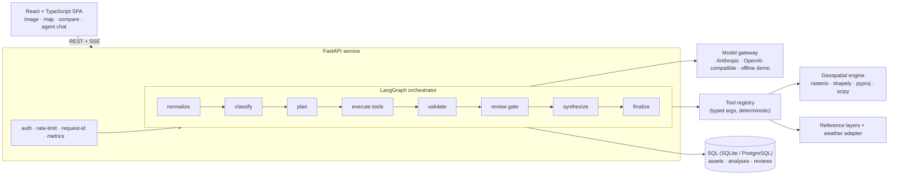

# TerraLens — GeoAI Agent

An **agentic geospatial intelligence assistant**: an LLM + vision-language-model (VLM) agent that plans an
analysis, calls **deterministic geospatial tools** to measure it, and answers with **evidence-backed,
auditable results** for five domains:

| Domain | What the agent does |
|---|---|
| 🌊 **Flood monitoring** | water extent, before/after growth, flooded buildings & roads, cut road sections, critical facilities, response order |
| 🔥 **Wildfire monitoring** | burn scars, active fire fronts, smoke, burned area, buildings / evacuation-zone exposure, wind-aware spread (inference) |
| 🏚️ **Earthquake impact** | per-building damage (intact / damaged / collapsed), debris-blocked roads, field-inspection triage |
| 🏙️ **Urban planning** | land-cover & change, new development, zoning conflicts, park accessibility |
| 🌾 **Crop health** | NDVI per field, stress anomalies, trend vs. earlier pass, scouting priorities |

It implements the plan and use-case in [`docs/plan.md`](docs/plan.md) / [`docs/usecase.md`](docs/usecase.md), including the
three reference interactions (detailed description with grounding, "give a bounding box for …", "is the whole road
flooded? / how many buildings are flooded?").

**▶ Live demo (static, GitHub Pages):** https://sadiqgpasha89.github.io/GeoAI-Agent/
The hosted site runs in *static demo* mode — every answer was pre-computed by the **real agent pipeline** (same graph,
tools and schemas as the API) and the UI replays the recorded agent trace. Connect your own backend from the UI
(**Settings → bottom-left status**) for free-form questions, uploads and live VLM analysis.

---

## Architecture



**Design principles** (from the plan, all enforced in code):

* **Evidence first.** Every observation carries a pixel polygon/bbox, optional WGS84 geometry, confidence, severity,
  `kind` (`observed` / `inferred` / `not_determinable`) and an evidence reference to the asset + tool that produced it.
* **Agentic, not opaque.** The planner chooses tools; **all numbers (areas, counts, distances, overlaps) come from
  deterministic tools**, never from the LLM. An LLM-refined plan is validated against the tool registry and *cannot drop
  the measurement tools* ([`agent/planner.py`](backend/src/geoai/agent/planner.py)).
* **VLM proposes, geometry verifies.** Without a reference layer, the VLM localises buildings/roads; overlap with the water
  mask etc. is then *measured* deterministically and confidence is capped.
* **Human-in-the-loop.** Low confidence, VLM-sourced footprints, contradictions between model and measurement, and
  high-consequence findings (impassable roads, collapsed structures, active fire…) set `needs_review`; analysts
  approve / reject / correct via the API or UI. Decisions are stored in a separate append-only table.
* **Provenance.** Each analysis stores the request hash, asset SHA-256s, tool calls (args, status, timings, output hash),
  model names, prompt versions and a record hash; completed records are immutable.
* **Graceful uncertainty.** Missing CRS/timestamp, mismatched image pairs, no NIR band, tool or model failures surface as
  explicit assumptions/limitations — the run degrades (e.g. to deterministic answers) instead of failing silently.
* **Pixel ≠ geographic.** `bbox_px`/`pixel_polygon` are image pixels (origin top-left); `geometry` is GeoJSON in EPSG:4326
  and is `null` for non-georeferenced images. Areas are only reported in m²/ha when a metric CRS is known.

### Tech stack (and why)

| Layer | Choice | Rationale |
|---|---|---|
| Agent orchestration | **LangGraph** | explicit state machine, conditional routing, streaming of node/tool events |
| Models | **Anthropic Claude** (vision) via a provider-neutral gateway; **OpenAI-compatible** adapter (vLLM/Ollama) for data-resident inference; offline **demo** engine | no lock-in, runs without credentials |
| API | **FastAPI + Pydantic v2**, SSE streaming, OpenAPI at `/api/docs` | typed contracts, async I/O, CPU work in a thread pool |
| Geospatial | **rasterio, shapely, pyproj, scipy, numpy** | CRS-aware, GeoTIFF + multispectral (NIR/NDVI), standard formats |
| Persistence | **SQLAlchemy 2** → SQLite (dev) / **PostgreSQL** (prod) | append-only provenance, tenant isolation |
| Frontend | **React 19 + TypeScript + Vite**, **Leaflet** | map-first workspace, tiny static bundle for Pages |
| Ops | Docker (non-root, read-only FS), docker-compose, GitHub Actions, Prometheus `/metrics`, JSON logs with request IDs | |

---

## Quick start

### Everything with Docker
```bash
cp .env.example .env            # optional: add ANTHROPIC_API_KEY for live VLM mode
docker compose up --build       # web http://localhost:8080 · API docs http://localhost:8000/api/docs
```

### Local development
```bash
make setup                      # venv + pip install -e backend[dev]; npm ci
make samples                    # generate the 5 synthetic scenes (deterministic)
make dev-api                    # http://localhost:8000   (offline demo engine unless ANTHROPIC_API_KEY is set)
make dev-web                    # http://localhost:5173   (talks to the API above)
make test                       # backend + frontend tests
make web                        # build the static site exactly as GitHub Pages does
```

### Use the API
```bash
curl -s localhost:8000/api/v1/analyses -H 'content-type: application/json' -d '{
  "question": "How many buildings are flooded?", "domain": "flood",
  "asset_id": "sample:flood-riverbend:after", "before_asset_id": "sample:flood-riverbend:before"}' | jq .answer

# your own imagery (PNG/JPEG/WebP/GeoTIFF, incl. 4-band R,G,B,NIR)
curl -s -F file=@scene.tif localhost:8000/api/v1/assets          # -> {"id": "a_…", "georeferenced": true, …}
```

| Endpoint | Purpose |
|---|---|
| `GET /api/v1/meta`, `/samples` | capabilities, tools, bundled scenes |
| `POST /api/v1/assets` · `GET …/{id}` · `GET …/{id}/preview` | validated upload (magic-byte sniffing, size/pixel limits, optional ClamAV), metadata, PNG preview |
| `POST /api/v1/analyses` | run the agent (sync) |
| `POST /api/v1/analyses/stream` | run the agent, streaming `start · step · tool_start · tool_end · result` as SSE |
| `GET /api/v1/analyses[/{id}]` · `…/export?format=geojson\|csv\|json\|html` | history and exports |
| `POST /api/v1/analyses/{id}/review` · `GET …/reviews` | human review decisions |
| `GET /healthz · /readyz · /metrics` | liveness, readiness, Prometheus |

### Configuration (environment, prefix `GEOAI_`)
See [`.env.example`](.env.example). Highlights: `GEOAI_API_KEYS` (`key:tenant,…`; **mandatory when `GEOAI_ENV=production`**),
`ANTHROPIC_API_KEY` (live mode; models via `GEOAI_MODEL_FAST` / `GEOAI_MODEL_VISION`), `GEOAI_PROVIDER=openai_compat` +
`GEOAI_OPENAI_BASE_URL` (local VLM), `GEOAI_DATABASE_URL` (PostgreSQL), `GEOAI_CORS_ORIGINS`, `GEOAI_MAX_UPLOAD_MB`,
`GEOAI_RATE_LIMIT_PER_MINUTE`, `GEOAI_CLAMAV_HOST`, `GEOAI_ENABLE_EXTERNAL_DATA` (live weather via Open-Meteo).

---

## Demo engine vs live engine

| | **Demo engine** (default, offline) | **Live engine** (`ANTHROPIC_API_KEY` or OpenAI-compatible endpoint) |
|---|---|---|
| Routing / planning | rules | LLM, validated against the tool registry |
| Perception | classical indices (NDWI/NDVI, colour/texture masks) + reference layers | VLM description, VQA and open-vocabulary grounding (boxes) |
| Measurements | deterministic tools | **same deterministic tools** (+ VLM proposals verified by geometry) |
| Answer | templated from ranked findings | LLM synthesis from structured evidence only, sanitised, falls back to the template on any failure |

Bundled scenes are **synthetic** (generated by [`samples/generate.py`](backend/src/geoai/samples/generate.py) with known ground truth,
before/after pairs, GeoTIFFs incl. a 4-band NIR scene and GeoJSON reference layers) so that no third-party imagery licences
are involved and the tools can be unit-tested against truth (e.g. exactly which buildings are collapsed).

## Security & governance

Input validation & limits · magic-byte upload sniffing · decompression-bomb guard · optional fail-closed malware scan ·
API-key auth with constant-time compare and **tenant isolation** · rate limiting · strict CORS · security headers & CSP ·
prompt-injection defences (untrusted-data prompts, registry-bound tool calls, injection requests declined before any model
call, output sanitisation, no URLs from models) · spreadsheet-injection-safe CSV export · secrets only via environment ·
non-root read-only container · no external actions are taken by the agent (alerts are *not* published automatically).

## Testing
`pytest` (≈55 tests): CRS/geometry maths, deterministic tools vs. ground truth, agent graph per domain, plan guardrails,
prompt-injection, live gateway with scripted fake backends (incl. model failure fallbacks), API auth/tenancy/upload/SSE/rate-limit.
`vitest` for the web client. GitHub Actions runs lint, tests, type-check, builds and Docker image builds.

## Known limitations
* Classical demo perception is tuned for the synthetic scenes; on arbitrary imagery use a VLM provider.
* Straight-line distances (no street-network routing); single-date indices cannot attribute causes (e.g. crop stress).
* Single-process rate limiter and in-process analysis execution — put an ingress limiter in front and move to a queue
  (Celery/arq) + object storage (S3) for multi-replica/high-volume deployments (storage and job boundaries are isolated for this).
* Image-derived estimates are **not official emergency measurements**; the UI, exports and answers say so.

## Repository layout
```
backend/src/geoai/   agent/ (LangGraph graph, planner, compose) · llm/ (gateways, prompts) · tools/ (domain tools) ·
                     geo/ (raster, georef, indices, vector) · storage/ · api/ · samples/ · export_static.py
backend/tests/       ground-truth tool tests, agent/LLM/API tests
frontend/src/        React app (image/map/compare views, agent panel, results, settings)
prototype/           the original static UI mock this project grew from
docs/                plan.md, usecase.md (problem statement) · architecture.md
.github/workflows/   ci.yml · pages.yml (builds the static demo with the real pipeline and deploys it)
```
